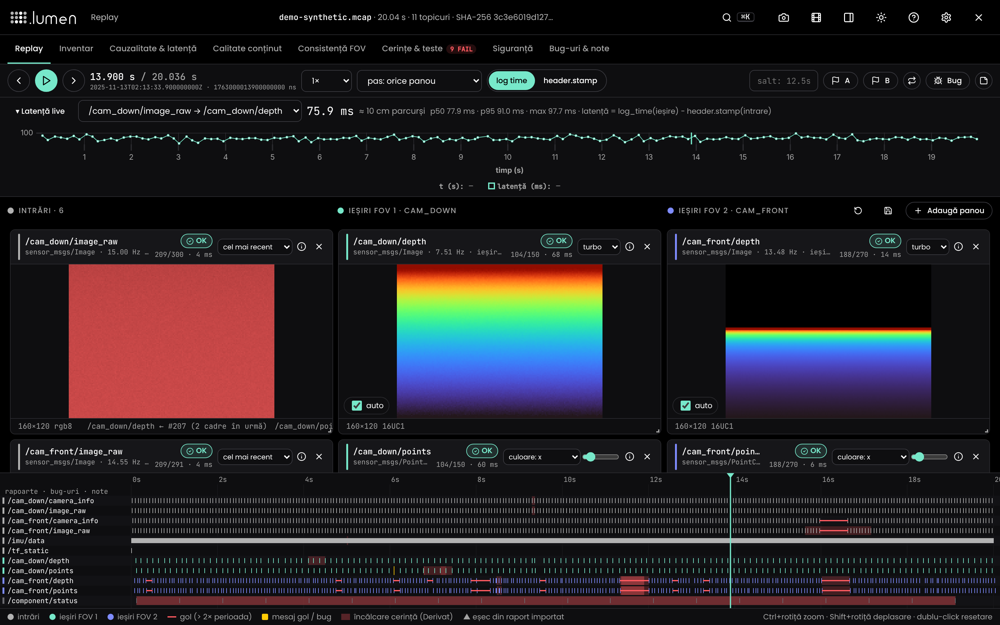
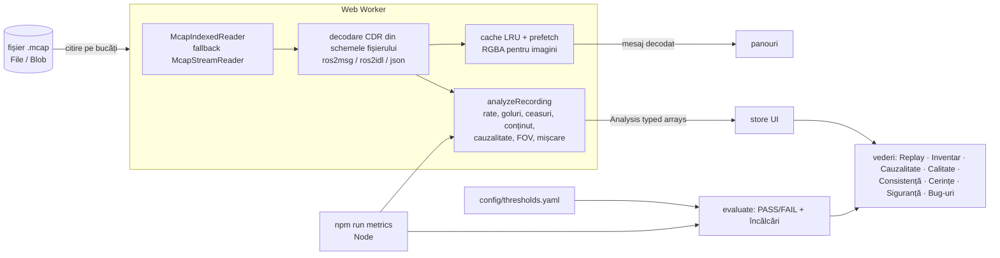
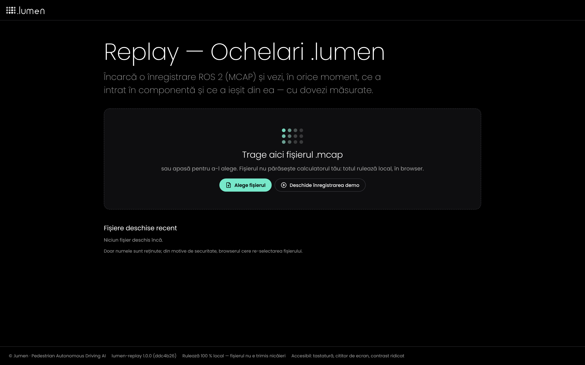
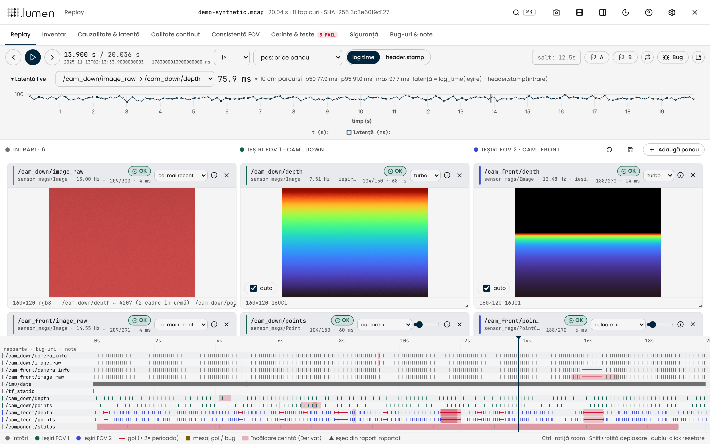
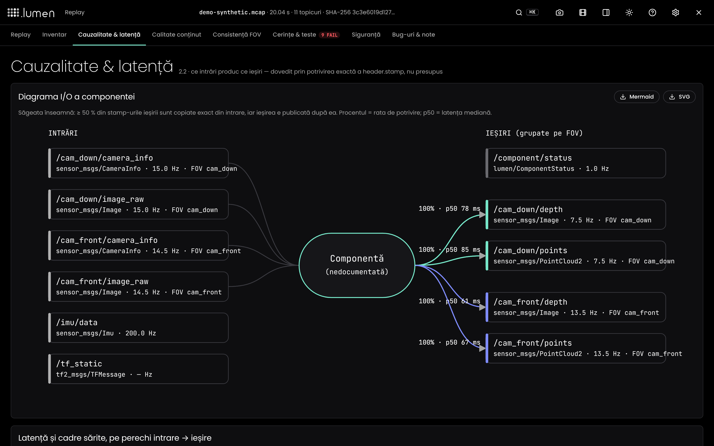
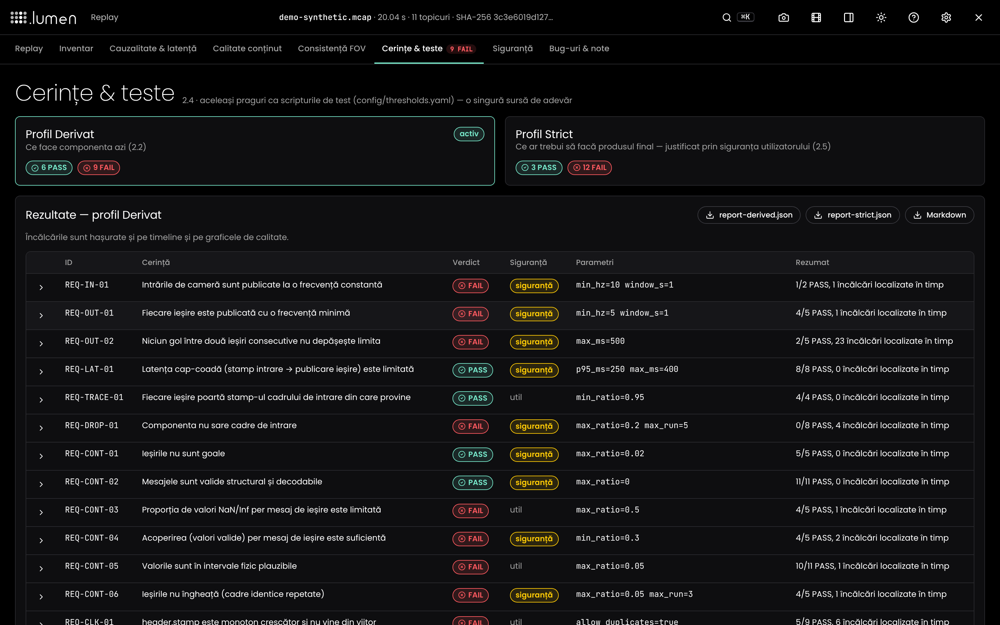
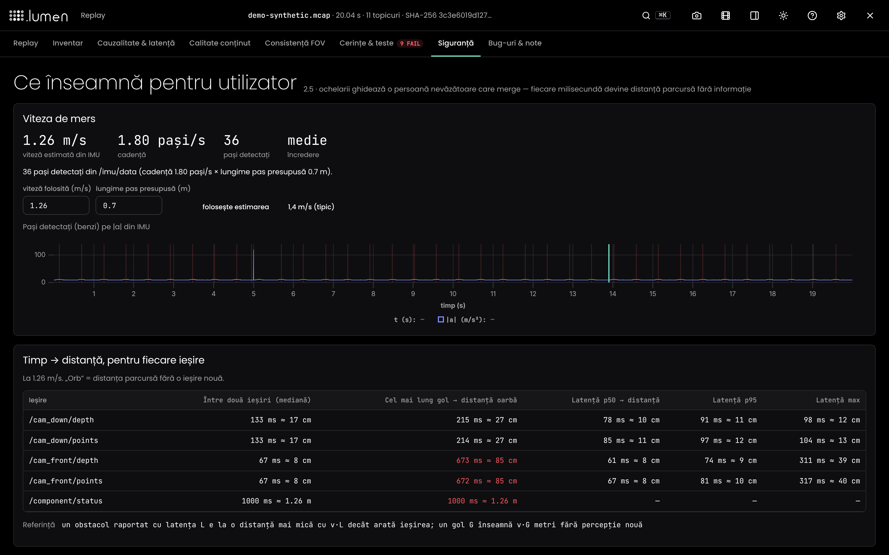

# .lumen Replay

Aplicație web de **replay sincronizat** pentru înregistrările ROS 2 (MCAP) ale Ochelarilor .lumen. Răspunde la sub-challenge-ul 2.8 din *dotLumen SW Test Challenge v4* și este, în același timp, instrumentul de analiză pentru 2.1–2.7: orice afirmație din document poate fi dovedită cu o măsurătoare din aplicație.



## Pornire rapidă

```bash
npm install
```

```bash
npm run dev
```

Deschide apoi http://localhost:5173 și apasă **„Deschide înregistrarea demo”**, sau trage un fișier `.mcap` în pagină. Înregistrarea demo e generată automat, sintetic, înainte de `dev` și de `build`.

| Comandă | Ce face |
|---|---|
| `npm run dev` | server de dezvoltare (generează `public/demo.mcap`) |
| `npm run build` | site static în `dist/` (typecheck + Vite) |
| `npm test` | 36 de teste unitare și de integrare (Vitest) |
| `npm run test:e2e` | 7 teste Playwright, inclusiv audit de accesibilitate axe-core în ambele teme |
| `npm run test:all` | typecheck + unit + build + e2e |
| `npm run inspect -- fișier.mcap [--schemas]` | inspectează o înregistrare reală: topicuri, tipuri, scheme, statistici, cauzalitate |
| `npm run metrics -- fișier.mcap --out out/` | `metrics.json`, `report-derived.json`, `report-strict.json`; codul de ieșire e 1 dacă profilul derivat are eșecuri |
| `npm run gen:synthetic -- out.mcap [--seconds 20] [--unindexed]` | generează înregistrarea sintetică |

Cu Docker:

```bash
docker build -t lumen-replay . && docker run --rm -p 8080:80 lumen-replay
```

## Arhitectură



- **`src/core/`** conține logica pură, fără UI și fără DOM, cu teste unitare. E folosită de Web Worker în browser și direct de CLI în Node, deci aplicația și testele calculează **cu același cod**.
  - `analyze.ts`: o singură trecere peste toate mesajele.
  - `causality.ts`: dovada intrare → ieșire.
  - `requirements.ts`: evaluarea cerințelor din YAML.
  - `projection.ts`: proiecție, Nelder–Mead, sensibilitate.
  - `content.ts`: metrici per mesaj.
  - `stats.ts`, `sync.ts`: statistici și căutare binară.
  - `sha256.ts`: hash incremental.
- **`src/worker/`**: citește indexat dintr-un `Blob`, deci un fișier de câțiva GB nu e încărcat în memorie. Are cache LRU (400 MB), prefetch al următoarelor cadre și decodare imagine → RGBA.
- **`src/panels/`**: panoul e ales după tipul mesajului:
  - Image și CompressedImage, inclusiv adâncime cu colormap și valoarea reală a pixelului;
  - PointCloud2 3D, TF, Marker, Pose, IMU, CameraInfo, OccupancyGrid, LaserScan;
  - pentru orice alt tip, arbore JSON cu grafic pentru orice câmp numeric;
  - suprapunere nor → imagine și comparație între două imagini.
- **`src/state/`**: store extern, acțiuni de redare, persistență per fișier (după SHA-256) și starea în URL (timp, vedere, layout, topicuri).

## Ce face, pe sub-challenge

| | Funcționalitate |
|---|---|
| **2.1** | Inventar exportabil (MD/CSV): tip, encoding, format, unități, `frame_id`, Hz medie, mediană, min și max, jitter, goluri. Pentru fiecare topic: histograma intervalelor, frecvența instantanee în timp, miniatură reprezentativă și analiza ceasurilor (log − stamp, stamp-uri nemonotone, duplicate sau din viitor). Clasificarea I/O e editabilă, cu motivul afișat. |
| **2.2** | Diagrama I/O **dedusă din dovezi**: un topic e ieșire dacă ≥ 50 % din `header.stamp`-uri sunt copiate exact dintr-o intrare și e publicat cu > 2 ms după ea. Export Mermaid și SVG. Latența apare cu p50/p90/p95/p99/max, histogramă și evoluție în timp, cu definiția scrisă lângă grafic. Arată cadrele sărite și secvențele lor, are cursoare A/B și propune o ciornă de cerințe cu ID, criteriu de acceptare și metodă de verificare. |
| **2.3** | Grupează ieșirile aceluiași FOV pe stamp, ca să se vadă dacă apar complete și în sincron. Verifică concordanța nor 3D ↔ imagine de adâncime în timp. Calibrarea vine din CameraInfo + TF, e introdusă manual sau e **estimată** (Nelder–Mead), cu încredere per parametru calculată din sensibilitatea costului la ±δ. |
| **2.4** | Profilurile *Derivat* și *Strict* se citesc din `config/thresholds.yaml`, aceeași sursă unică pe care o folosesc CLI-ul și scripturile de test. Rezultatul e PASS/FAIL/N/A, cu fiecare încălcare localizată în timp: click pe ea face salt în replay, iar pe timeline și pe grafice apare hașurată. Se verifică și conținutul: NaN, zero, acoperire, valori în afara intervalului plauzibil, mesaje goale sau invalide, cadre înghețate. Rapoartele se pot importa (apar ca markere) și compara, iar validarea încrucișată compară `metrics.json` al aplicației cu cel al scripturilor. |
| **2.5** | Viteza de mers e estimată din IMU prin detecția pașilor; altfel se presupune 1,4 m/s, iar valoarea se poate edita. Fiecare latență și fiecare gol sunt traduse în **centimetri parcurși**. O vedere separată arată doar cerințele critice pentru siguranță și cele mai grave momente din înregistrare. |
| **2.6** | Butonul „Creează bug” generează un raport cu severitate, cerința afectată, interval, valoare măsurată față de cea așteptată și capturi PNG. Pașii de reproducere includ un deep-link la moment și comanda CLI care reproduce eșecul. Export ZIP cu Markdown și imagini. |
| **2.7** | Note și întrebări ancorate în timp, cu tag și prioritate, exportate ca listă ordonată. Un registru de presupuneri se actualizează automat cu tot ce a presupus aplicația. |

**Trasabilitate.** Orice export include SHA-256 al fișierului, versiunea aplicației (git commit), profilul și hash-ul pragurilor, calibrările și viteza folosită. Calculele sunt deterministe: nu se eșantionează mesaje, ci doar pixeli în interiorul unui mesaj, după o sub-grilă fixă, documentată.

## Înregistrarea sintetică (date de test cu defecte cunoscute)

Înregistrarea reală nu e inclusă în repo, așa că `scripts/gen-synthetic.ts` generează o înregistrare deterministă cu aceeași structură:
- două camere = două FOV-uri;
- IMU la 200 Hz cu mers la 1,8 pași/s;
- CameraInfo și TF static;
- o componentă care produce imagine de adâncime 16UC1 și PointCloud2 pentru fiecare FOV.

Defectele injectate, pe care testele verifică faptul că aplicația le găsește:

| Defect | Unde | Detectat de |
|---|---|---|
| vârf de latență +250 ms | `cam_front` cadrele 120–125 | REQ-LAT-01 (strict), graficul de latență |
| cadre sărite: 4 % aleator + secvența 170–178 | `cam_front` | REQ-DROP-01, REQ-OUT-02 |
| gol de intrare ≈ 0,6 s | `/cam_front/image_raw` 240–248 | REQ-IN-01, timeline |
| procesare la jumătate de rată | FOV `cam_down` | REQ-DROP-01, rata ieșire / intrare = 0,5 |
| adâncime înghețată | `/cam_down/depth` 60–66 | REQ-CONT-06 |
| nor gol / 70 % NaN | `/cam_down/points` 90 / 100–110 | REQ-CONT-01, -03, -04 |
| stamp nemonoton | `/cam_down/image_raw` cadrul 140 | REQ-CLK-01 |
| \|a\| = 120 m/s² | IMU la 5 s | REQ-CONT-05 |
| nor deplasat cu +0,8 m | `cam_front` 200–215 | consistența nor ↔ adâncime (2.3) |

## Accesibilitate

.lumen face tehnologie asistivă, așa că aplicația țintește **WCAG 2.2 AA**:
- auditul axe-core rulează automat în e2e, în ambele teme, fără încălcări serioase sau critice;
- totul se poate folosi din tastatură: skip link, focus trap în ferestrele modale, inel de focus vizibil;
- timeline-ul e un `slider` ARIA cu `aria-valuetext` („12,4 secunde din 95”);
- starea nu e transmisă niciodată doar prin culoare: fiecare stare are iconiță și text;
- o regiune `aria-live` anunță golurile de date în timpul redării;
- există mod de contrast ridicat, textul se poate mări până la 200 %, iar `prefers-reduced-motion` e respectat.

Scurtături: `Space` redă sau oprește, `←/→` mută cu un cadru, `Shift+←/→` cu ±1 s, `[ ]` schimbă viteza, `A/B` pun cursoarele, `L` pornește bucla, `N` adaugă o notă, `I` deschide inspectorul, `Ctrl/⌘+K` paleta de comenzi, `1–8` comută vederile, `?` deschide ajutorul.

## Limitări cunoscute și presupuneri

- Cauzalitatea se dovedește doar prin `header.stamp` identic. O componentă care nu copiază stamp-ul intrării nu poate fi legată automat de intrarea ei; rolul se setează atunci manual în Inventar.
- Latența cap-coadă presupune că `log_time` e ceasul recorderului și că stamp-ul e momentul achiziției.
- YUV 4:2:2 e afișat doar ca luminanță. Imaginile comprimate sunt decodate de browser (JPEG/PNG).
- Estimarea calibrării are nevoie de o ieșire de adâncime ca referință pentru același stamp. Fără ea se folosește doar procentul de puncte care cad în imagine.
- Detecția pașilor presupune o lungime a pasului de 0,7 m, editabilă.
- Pentru fișiere neindexate sau trunchiate, mesajele sunt citite secvențial și ținute în memorie.
- Alternativa propusă în prompt (backend Python) nu a fost necesară: citirea indexată din `Blob` și worker-ul fac față fișierelor mari în browser.

## Capturi

| | |
|---|---|
|  |  |
|  |  |
|  |  |

Paragraful pentru secțiunea „Implementation” a documentului challenge-ului se află în [IMPLEMENTATION.md](IMPLEMENTATION.md).
